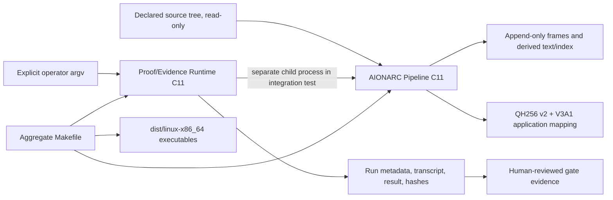

# Aggregate Architecture

## Architectural layers

1. **Source boundary:** an operator declares a filesystem root. The AIONARC scanner observes it without intentionally modifying source files. The output store must be separate and non-overlapping.
2. **Structural memory:** state rows, object identity, source hashes, frame transitions and proof records capture observations. The frame chain is append-only; failed/staged work is preserved rather than promoted.
3. **Derived text and index:** supported extraction is bounded and source-bound. PDF text extraction delegates to optional `pdftotext`. The index is validated and is required to reconstruct the profile mapping; retrieval is exact lexical AND, not semantic search.
4. **QH256:** the unchanged v2 core supplies the four-state algebra and serialization. AIONARC's V3A1 mapping is component-specific. The aggregate does not map recorder statuses to QH256.
5. **Evidence capture:** the recorder executes a declared argv vector as a separate process, captures merged stdout/stderr and bounded host metadata, records actual exit and hashes. It does not judge semantics or close gates.
6. **Aggregate orchestration:** top-level Make targets sequence clean builds, component tests, process-level integration and integrity checks. `dist/` contains copies of the built executables.

## Trust and security boundary

SHA-256 manifests detect byte differences relative to the manifest value; they are not signatures or an independent trust anchor. A writer able to replace all files and hashes can create a new consistent tree. No encryption, remote witness, signed build, multi-writer lock, hostile-store defense, or full environment capture is supplied. Do not pass secrets as command arguments: the recorder stores argv in evidence.

## Version boundary

The aggregate version is an integration candidate identity. It does not claim that upstream component internals have been re-versioned to 3.5.0. Changes to the AIONARC mapping or component schemas require their own component-level version and compatibility review.
